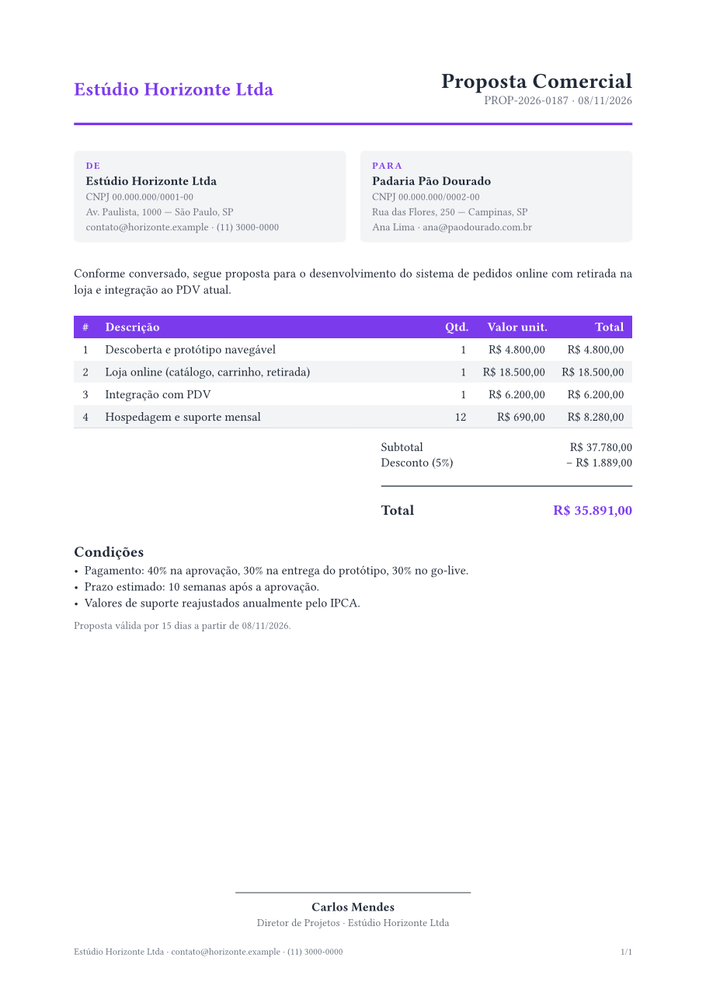

# Examples

Each file below is a template from `skills/typst-to-pdf/assets/` compiled with `typst compile` (Typst 0.13.1). Only the sample strings (company name, tax ID, signer) were swapped for neutral placeholders; layout and code are unchanged.

| Template | PDF | Preview |
|---|---|---|
| `resume` | [resume.pdf](pdf/resume.pdf) | [page 1](preview/resume-1.png) |
| `report` | [report.pdf](pdf/report.pdf) | [cover](preview/report-1.png) |
| `proposal` | [proposal.pdf](pdf/proposal.pdf) | [page 1](preview/proposal-1.png) |
| `letter` | [letter.pdf](pdf/letter.pdf) | [page 1](preview/letter-1.png) |
| `banner` (preset `social`) | [banner.pdf](pdf/banner.pdf) | [banner.png](preview/banner.png) |

